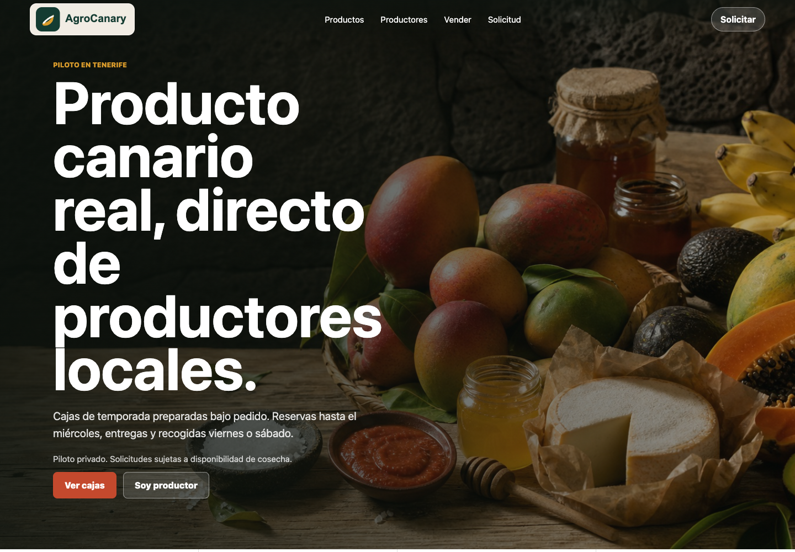
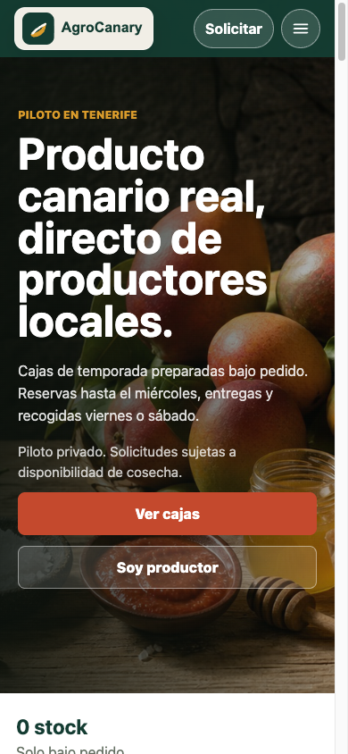

<p align="center">
  
</p>

# AgroCanary

A static, installable marketplace pilot for Canary Islands produce, with producer profiles and manual order enquiries.

## Preview



Captured from a local source-only preview without real accounts or private records.

[](https://github.com/Fernise/AgroCanary/actions/workflows/ci.yml)

**Technology:** HTML · CSS · JavaScript · PWA · Vercel

[Overview](#what-it-does) · [Quick start](#quick-start) · [Architecture](docs/ARCHITECTURE.md) · [Verification](docs/VERIFICATION.md)

## What it does

For Canary Islands growers and buyers exploring direct produce enquiries.

- Producer directory and individual farm profiles.
- A dedicated grower onboarding page and pilot information.
- Mobile-friendly browsing, an installable PWA and offline caching.
- Email-based enquiry flows, with an optional server-side Resend adapter.

## Screenshots

<details>
<summary>Mobile view</summary>



The local landing page; no order or enquiry was submitted.

</details>

## Project status

Demand-validation MVP. Availability, order confirmation and fulfilment are manual; the project does not hold stock, process payments or promise realtime inventory.

## Quick start

Requires Node.js 22 or newer. There are no runtime packages to install.

```sh
git clone https://github.com/Fernise/AgroCanary.git
cd AgroCanary
npm run dev
```

Open `http://127.0.0.1:8000`. The local server exposes only website assets, keeping environment files and server source inaccessible.

The preview serves static pages. To use the optional email endpoint, deploy `api/contact.js` on Vercel and configure `RESEND_API_KEY`, `CONTACT_FROM_EMAIL` and `CONTACT_TO_EMAIL` privately. The supplied `.env.example` contains no credentials. Do not commit a populated environment file.

## Verification

```sh
npm run check
npm test
```

Tests exercise the preview server's boundary around credentials, hidden files and server source. Contact delivery and a real producer/order pilot require separate operational verification.

## Repository map

| Path | Responsibility |
| --- | --- |
| `*.html` | Public pages, producer directory and legal copy |
| `assets/` | Website images and branding |
| `api/contact.js` | Optional server-side email endpoint |
| `scripts/serve.mjs` | Local website preview with a restricted file boundary |
| `tests/` | Preview security regression test |

## Documentation

- [Verification record and limits](docs/VERIFICATION.md)
- [Architecture and data boundaries](docs/ARCHITECTURE.md)
- [Configuration](docs/CONFIGURATION.md)
- [Security policy](SECURITY.md)
- [Contribution guidance](CONTRIBUTING.md)
- [Third-party notices](THIRD_PARTY_NOTICES.md)

## License

All rights reserved. See [LICENSE](LICENSE).

Third-party libraries and assets retain their own licenses.
